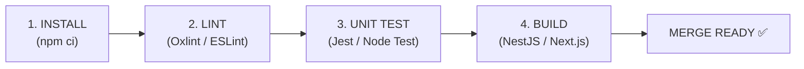

# 📜 Definition of Done (DoD) — Dự án BrewLite

**Dự án:** BrewLite — Hệ thống đặt cà phê trực tuyến  
**Môn học:** Công nghệ phần mềm (SWE) — Đại học Sài Gòn  
**Người phụ trách chuẩn hóa:** Phạm Gia Khôi — Trưởng nhóm, phụ trách tích hợp & quy trình CI  
**Áp dụng:** Toàn bộ thành viên và các module trong Sprint 1 & Sprint 2  

---

## 1. Nguyên tắc cốt lõi

Một hạng mục công việc (Feature, User Story, Task kỹ thuật, hoặc Bug Fix) chỉ được coi là **DONE** (Hoàn thành) và đủ điều kiện merge vào nhánh chính (`main`) khi thỏa mãn đầy đủ **10 tiêu chí bắt buộc** dưới đây. Không có ngoại lệ "nợ kỹ thuật" hoặc "làm sau".

---

## 2. Danh sách 10 tiêu chí Definition of Done

| STT | Tiêu chí | Mô tả chi tiết & Yêu cầu xác minh | Bằng chứng yêu cầu |
|---|---|---|---|
| **1** | **Có yêu cầu FR/US hoặc Issue tương ứng** | Tính năng bắt buộc phải truy vết ngược về một User Story (US) hoặc Yêu cầu chức năng (FR) được phê duyệt trong Task 1 (SRS/Scope). | Mã US-xx / FR-xx trong tiêu đề PR và commit message. |
| **2** | **Có thiết kế liên quan được đối chiếu** | Hành vi và cấu trúc dữ liệu phải khớp với mô hình UML tương ứng (Use Case, Activity, Sequence, Class Diagram) của Task 2 và kiến trúc ADR của Task 3. | Chỉ rõ lớp (Class), phương thức, lifeline hoặc activity node tương ứng trong thiết kế. |
| **3** | **Có code thực tế (Source Code)** | Mã nguồn được triển khai sạch sẽ, tuân thủ kiến trúc phân lớp (Layered Architecture) và Modular Monolith; không hardcode dữ liệu giả vào UI. | File code trong `frontend/src` hoặc `backend/src`. |
| **4** | **Có kiểm thử tự động (Automated Tests)** | Đi kèm unit tests và API/integration tests kiểm chứng cả luồng thành công (happy path) và các nhánh lỗi/biên (error/edge cases). | File test (`.spec.ts`, `.test.mjs`) chạy pass 100%. |
| **5** | **Linting thành công (Clean Lint)** | Toàn bộ mã nguồn vượt qua công cụ kiểm tra quy chuẩn mã nguồn: Oxlint cho Backend và ESLint cho Frontend; 0 errors, 0 warnings. | Lệnh `npm run lint` ở cả hai ứng dụng trả về exit code 0. |
| **6** | **Build production thành công** | Trình biên dịch TypeScript và bundler biên dịch thành công mà không có lỗi kiểu tĩnh hay lỗi bundle: NestJS build và Next.js build. | `npm run build` ở backend và frontend thành công. |
| **7** | **Bảo mật tuyệt đối (Zero Secrets in Git)** | Tuyệt đối không commit file chứa credentials, token bí mật, API key thật hoặc mật khẩu vào Git repository. Chỉ dùng `.env.example`. | Quét Git tracking: không có file `.env` hoặc secret commit. |
| **8** | **Có bằng chứng nghiệm thu (Verification Evidence)** | Có log kiểm thử, curl output thực tế hoặc ảnh chụp màn hình kiểm chứng giao diện responsive (kể cả mobile 360px). | Log terminal, test reports trong thư mục `docs/`. |
| **9** | **Có Pull Request và Review trước Merge** | Mọi thay đổi phải đi qua Pull Request trên GitHub với đầy đủ PR template, được ít nhất 1 thành viên review và phê duyệt. | Link PR trên GitHub với trạng thái Approved. |
| **10** | **Ma trận truy vết được cập nhật (Traceability Updated)** | File `docs/traceability-matrix.md` hoặc `TASK4_KHOI_TRACEABILITY.md` được cập nhật đồng bộ trạng thái IMPLEMENTED / VERIFIED. | Dòng cập nhật tương ứng trong bảng truy vết. |

---

## 3. Quy trình nghiệm thu chất lượng (Quality Gate Verification)

Mỗi Pull Request trước khi merge vào `main` phải vượt qua pipeline CI GitHub Actions gồm 4 bước tuần tự:

Nếu bất kỳ bước nào thất bại, Pull Request bị chặn tự động bởi GitHub Branch Protection Rule.

---

## 4. Phân định trách nhiệm thành viên (Attribution & Ownership)

- **Trí:** Chịu trách nhiệm module `Products API` (`backend/src/products/*`).
- **Đông:** Chịu trách nhiệm module `Menu UI & Components` (`frontend/src/components/menu/*`).
- **Điệp:** Chịu trách nhiệm cơ sở dữ liệu `Prisma & PostgreSQL` (`backend/prisma/*`, `docker-compose.yml`).
- **Kiệt:** Chịu trách nhiệm thiết kế kiểm thử & kiểm soát chất lượng (`tests/`, `*.spec.ts`).
- **Duy:** Chịu trách nhiệm quản lý tài liệu Task 1–3, backlog và issue board.
- **Khôi:** Chịu trách nhiệm tích hợp hệ thống, CI workflow, kiến trúc monorepo và nghiệm thu Sprint.
