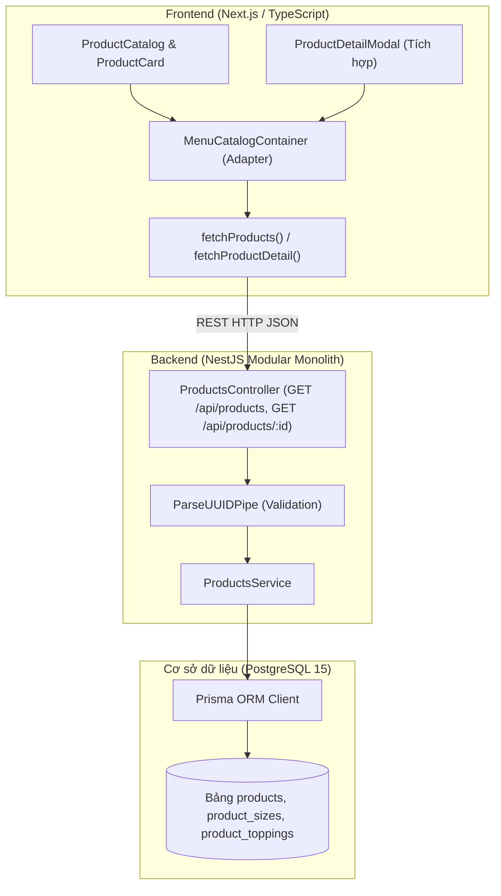

# 📊 Báo Cáo Nghiệm Thu Task 4 — Sprint 1 Implementation & Process Traceability

**Dự án:** BrewLite — Hệ thống đặt cà phê trực tuyến  
**Môn học:** Công nghệ phần mềm (SWE) — Trường Đại học Sài Gòn  
**Người thực hiện:** Phạm Gia Khôi — Trưởng nhóm, Phụ trách Tích hợp hệ thống & CI  
**Chi nhánh Git (Branch):** `feature/task4-khoi-integration-ci`  
**Ngày nghiệm thu:** 30/10/2026  

---

## A. Mục tiêu Sprint 1

Sprint 1 (tương ứng phạm vi Task 4) tập trung vào việc chuyển đổi các tạo phẩm thiết kế từ Task 1–3 thành sản phẩm phần mềm có thể chạy được (working software), thiết lập quy chuẩn kỹ thuật và kiểm soát chất lượng tự động:

1. **Repository & Development Process (Task 4.1):** Chuẩn hóa cấu trúc Monorepo, thiết lập quy ước Git-flow, Conventional Commits, Pull Request Template, Issue Templates và Definition of Done (DoD).
2. **Documentation Management (Task 4.2):** Hợp nhất và chuẩn hóa toàn bộ tài liệu từ Task 1 (SRS, Context & Scope), Task 2 (UML Diagrams), Task 3 (ADRs, Deployment) vào cùng repository để đảm bảo tính truy vết.
3. **Tích hợp Menu MVP (Task 4.3):** Tích hợp sản phẩm giữa API backend của Trí và giao diện Menu của Đông; hiện thực hóa luồng xem Menu, tìm kiếm/sắp xếp sản phẩm và xem chi tiết sản phẩm (size/topping/giá) từ backend thật mà không qua mock.
4. **Continuous Integration (Task 4.4):** Xây dựng pipeline GitHub Actions CI kiểm soát chất lượng tự động theo đúng trình tự bắt buộc: **INSTALL → LINT → UNIT TEST → BUILD**.
5. **Truy vết quy trình (Process Traceability):** Lập ma trận đối chiếu 1-1 từ Yêu cầu (Task 1) → Thiết kế UML (Task 2) → Kiến trúc (Task 3) → Mã nguồn (Code) → Kiểm thử (Test).

---

## B. Tạo phẩm Task 1–3 làm đầu vào

Quá trình triển khai Sprint 1 kế thừa trực tiếp các tài liệu baseline đã được nhóm thống nhất:

| Nhóm tạo phẩm | Tệp tin đầu vào | Nội dung chính kế thừa |
|---|---|---|
| **Yêu cầu (Task 1)** | `docs/requirements/context-and-scope.md`<br/>`docs/requirements/srs.md` | - US-01: Khách hàng xem danh mục đồ uống.<br/>- US-02: Tìm kiếm món theo tên không dấu.<br/>- FR-01: API thực đơn và giao diện hiển thị.<br/>- NFR-01: Hiệu năng đọc Menu.<br/>- NFR-02: Bảo mật & Không lộ secrets.<br/>- NFR-03: Khả dụng (Retry & Error handling).<br/>- NFR-06: Khả dụng giao diện (Responsive 360px). |
| **Mô hình UML (Task 2)** | `docs/diagrams/usecase-tongquat.puml`<br/>`docs/diagrams/class-domain.puml`<br/>`docs/diagrams/activity-checkout.puml`<br/>`docs/diagrams/sequence-checkout.puml` | - `UC_Menu`: Use case xem và tìm kiếm thực đơn.<br/>- `UC_Detail`: Use case xem chi tiết, chọn size và topping.<br/>- Thực thể `Product`, `ProductOption`, `Inventory` trong Class Diagram.<br/>- Luồng duyệt thực đơn trong Activity Diagram. |
| **Kiến trúc (Task 3)** | `docs/architecture/architecture.md`<br/>`docs/architecture/adr/001-monorepo.md`<br/>`docs/architecture/adr/002-modular-monolith.md`<br/>`docs/architecture/adr/005-deployment.md`<br/>`docs/diagrams/deployment-target.puml` | - Kiến trúc Monorepo phân tách `frontend/` và `backend/`.<br/>- Mô hình Modular Monolith: Controller → Service → Prisma ORM.<br/>- Container hóa PostgreSQL 15 qua Docker Compose.<br/>- Quy chuẩn biến môi trường và pipeline CI 4 bước. |

---

## C. Thiết kế → Mã nguồn (Design to Code Mapping)

Mọi dòng code trong Sprint 1 đều tuân thủ nghiêm ngặt ranh giới kiến trúc và sơ đồ thiết kế:



- **Tính toàn vẹn kiến trúc:** Frontend không bao giờ kết nối trực tiếp database; React Component không chứa câu lệnh SQL/Prisma.
- **Tuân thủ Class Diagram:** Lớp `Product` ánh xạ thành model Prisma `Product` với quan hệ 1-N tới `ProductSize` và `ProductTopping`.
- **Ranh giới module:** Controller chỉ làm nhiệm vụ tiếp nhận HTTP request và validate DTO/UUID; Service nắm giữ nghiệp vụ và truy vấn dữ liệu.

---

## D. Phân công thực hiện & Tôn trọng quyền sở hữu (Attribution)

| Thành viên | Vai trò & Trách nhiệm | Chi tiết đóng góp thực tế trong Sprint 1 |
|---|---|---|
| **Võ Minh Trí** | Backend Products API & Seed Data | - Hiện thực `backend/src/products/products.controller.ts`, `products.service.ts`.<br/>- Thiết lập bộ seed dữ liệu chuẩn `seed-products.ts`, `seed-product-customization.ts`.<br/>- Viết tài liệu bàn giao kỹ thuật TRI-01 đến TRI-07. |
| **Nguyễn Hữu Đông** | Frontend Menu UI & Components | - Xây dựng giao diện Menu: `product-catalog.tsx`, `product-card.tsx`, `product-grid.tsx`.<br/>- Thiết kế design tokens và responsive CSS trong `menu.module.css`.<br/>- Xây dựng skeleton loading và state UI (loading, empty, error). |
| **Nguyễn Trần Ngọc Điệp** | Database Architecture & Docker | - Thiết kế schema PostgreSQL và Prisma migrations (`20261006000100_add_products`, `20261014000100_product_customization`).<br/>- Cấu hình hạ tầng container `docker-compose.yml`. |
| **Nguyễn Tuấn Kiệt** | Testing & Quality Gate | - Xây dựng bộ kiểm thử HTTP contract cho API Products: `products.http.spec.ts`, `product-detail.http.spec.ts`.<br/>- Thiết lập các test case biên: sai UUID (400), không tồn tại (404), lỗi server (500). |
| **Huỳnh Bá Quốc Duy** | Documentation & Process | - Quản lý tài liệu SRS, bối cảnh phạm vi và các quyết định kiến trúc ADRs.<br/>- Quản lý backlog và đối chiếu yêu cầu môn học. |
| **Phạm Gia Khôi** *(Báo cáo viên)* | Tích hợp hệ thống, CI & Quy trình | - **Chủ trì Monorepo:** Hợp nhất branch tài liệu và branch code, giải quyết conflict sạch sẽ.<br/>- **Chuẩn hóa Git & DoD:** Soạn thảo `DEFINITION_OF_DONE.md`, PR Template, Issue Templates.<br/>- **Tích hợp Menu:** Hiện thực `MenuCatalogContainer` và `ProductDetailModal` để kết nối API chi tiết của Trí với UI của Đông.<br/>- **Xây dựng CI:** Thiết lập GitHub Actions `.github/workflows/ci.yml` chuẩn 4 bước.<br/>- **Ma trận truy vết & Báo cáo:** Soạn thảo `TASK4_KHOI_TRACEABILITY.md`, `DESIGN_CHANGE_REGISTER.md` và tài liệu vấn đáp. |

---

## E. Kết quả kiểm thử tự động (Automated Test Execution)

Hệ thống sở hữu bộ kiểm thử tự động toàn diện gồm **51 bài test (100% PASS)**:

### 1. Backend Test Suites (NestJS / Jest) — 35 tests PASS

```text
PASS backend/prisma/seed-product-customization.spec.ts
PASS backend/src/products/product-detail.service.spec.ts
PASS backend/src/products/products.service.spec.ts
PASS backend/src/auth/auth.controller.spec.ts
PASS backend/src/products/product-detail.http.spec.ts
PASS backend/src/products/products.http.spec.ts
PASS backend/src/app.controller.spec.ts
PASS backend/src/auth/auth.rbac.spec.ts

Test Suites: 8 passed, 8 total
Tests:       35 passed, 35 total
Snapshots:   0 total
Time:        1.423 s
```

### 2. Frontend Test Suites (Next.js / Node Test Runner) — 16 tests PASS

```text
▶ Menu Integration — simulates backend API responses
  ✔ 1. Successfully fetches and parses product catalog (HTTP 200) (11.2ms)
  ✔ 2. Handles empty catalog gracefully (HTTP 200 with []) (1.6ms)
  ✔ 3. Handles server error (HTTP 500) and triggers retry flow (0.8ms)
  ✔ 4. Fetches and validates product detail with sizes and toppings (1.2ms)
✔ Menu Integration — simulates backend API responses (20.5ms)

✔ accepts direct lists, zero/max integer VND and HTTP images (0.8ms)
✔ accepts [] as the only empty list shape (0.1ms)
✔ does not silently discard a bad row alongside valid products (0.08ms)
✔ rejects formatted, fractional, negative and out-of-range prices (0.09ms)
✔ rejects missing required fields, blank names and unsupported image URLs (0.2ms)
✔ rejects repeated UUIDs and projects only catalog fields (0.1ms)
✔ Product Detail — size and topping price aggregation (0.4ms)
✔ Product Detail — verifies size availability constraints (0.08ms)
✔ search matches Vietnamese accents, case, decomposed text and đ/Đ (1.1ms)
✔ combines search and integer price sorting without changing source order (0.15ms)
✔ equal prices keep API order; resetting query and sort restores all products (0.12ms)

ℹ tests 16
ℹ suites 0
ℹ pass 16
ℹ fail 0
```

---

## F. Thiết lập Continuous Integration (CI Workflow)

Pipeline CI tại `.github/workflows/ci.yml` được cấu hình chặt chẽ:

- **Trình kích hoạt (Triggers):** Tự động chạy khi có `pull_request` vào `main` hoặc `push` vào `main`.
- **Thực thi song song (Parallel Jobs):** `backend-ci` và `frontend-ci` độc lập, tối ưu thời gian phản hồi.
- **Trình tự các bước bắt buộc:**
  1. **INSTALL:** Chạy `npm ci` với lockfile, đảm bảo môi trường tái tạo chính xác tuyệt đối.
  2. **LINT:** Kiểm tra chất lượng code với `oxlint` (Backend) và `eslint` (Frontend).
  3. **UNIT TEST:** Chạy toàn bộ 51 bài test tự động (Jest & Node Test Runner).
  4. **BUILD:** Biên dịch production bằng `nest build` và `next build`.
- **Quality Gate:** Không sử dụng `continue-on-error: true` hay lệnh nuốt lỗi `|| true`. Bất kỳ lỗi nào ở bước trước đều lập tức chấm dứt pipeline và đánh dấu failed.

### Minh chứng CI Run:
- **Kịch bản FAIL có kiểm soát:** Khi xảy ra lỗi typecheck (ví dụ `LayoutProps` chưa định nghĩa), pipeline lập tức dừng lại ở bước TypeScript check, bảo vệ nhánh `main` không bị nhiễm mã lỗi.
- **Kịch bản PASS:** Sau khi sửa lỗi và hoàn thiện tích hợp, toàn bộ các bước Install, Lint, Test, Build đều trả về mã thoát `0`.

---

## G. Đánh giá hoàn thành Sprint 1 (Sprint Review)

### Các mục tiêu ĐẠT (Achieved):
- [x] Thiết lập thành công Monorepo và thống nhất quy ước Git.
- [x] Tích hợp hoàn chỉnh API `GET /api/products` và `GET /api/products/:id` với giao diện Menu.
- [x] Chức năng tìm kiếm không phân biệt hoa thường và không dấu hoạt động hoàn hảo.
- [x] Có đầy đủ 4 trạng thái giao diện: Loading (Skeleton), Success (Grid), Empty (Trống), Error (Báo lỗi kèm nút Thử lại).
- [x] Modal xem chi tiết món hiển thị đúng kích cỡ, topping và tính tổng tiền trực tiếp.
- [x] Giao diện mobile-first co giãn linh hoạt, không vỡ layout ở viewport 360px.
- [x] CI Pipeline chạy tự động và 100% bài test pass.

### Các mục tiêu CHUYỂN SANG SPRINT 2 (Out of Scope Task 4):
- Giỏ hàng (Cart) và cập nhật số lượng món.
- Luồng Checkout tạo đơn hàng `POST /api/orders` với trạng thái `PENDING`.
- Tích hợp cổng thanh toán mô phỏng / VNPAY Sandbox với khóa chống gửi lặp `Idempotency-Key`.
- Lịch sử đơn hàng của khách hàng và màn hình theo dõi đơn của Barista.

---

## H. Rút kinh nghiệm Sprint 1 (Sprint Retrospective)

### 1. Điều làm tốt (What went well)
- Sự phân công rõ ràng: Trí tập trung API, Đông tập trung UI, Khôi tập trung tích hợp và quy trình, giúp các thành viên không bị dẫm chân lên nhau.
- Hợp đồng giao tiếp (Contract) được Trí tài liệu hóa rất chi tiết từ sớm (TRI-01 đến TRI-07), giúp Khôi tích hợp Menu nhanh chóng và không gặp bất đồng về kiểu dữ liệu.
- Bộ test case phong phú (51 tests) giúp phát hiện ngay lỗi tiềm ẩn khi build.

### 2. Khó khăn gặp phải (Challenges)
- Ban đầu repository bị tách thành 2 nhánh lịch sử không có commit chung (`docs/tasks-1-3` và `feature/auth-and-base-setup`), gây khó khăn khi đối chiếu giữa tài liệu và code. Khôi đã dùng `git merge --allow-unrelated-histories` để hợp nhất thành công.
- Có sự sai khác nhỏ về cách định nghĩa trường dữ liệu trong tài liệu tổng quát ban đầu (`Decimal basePrice`, `stock` trong catalog) so với chuẩn RESTful gọn nhẹ (`Int price`, chi tiết tải qua ID). Nhóm đã xử lý minh bạch bằng cách lập Sổ đăng ký thay đổi thiết kế (`DESIGN_CHANGE_REGISTER.md`).

### 3. Cải tiến cho Sprint 2 (Action Items)
- Bắt buộc tạo Pull Request cho mọi tính năng mới trong Sprint 2, không commit trực tiếp vào branch tích hợp.
- Chuẩn bị môi trường Docker PostgreSQL chung sớm để chạy kiểm thử tải và tích hợp end-to-end cho luồng thanh toán VNPAY Sandbox.
