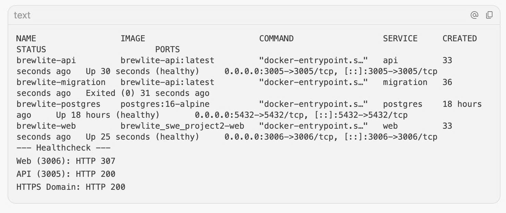
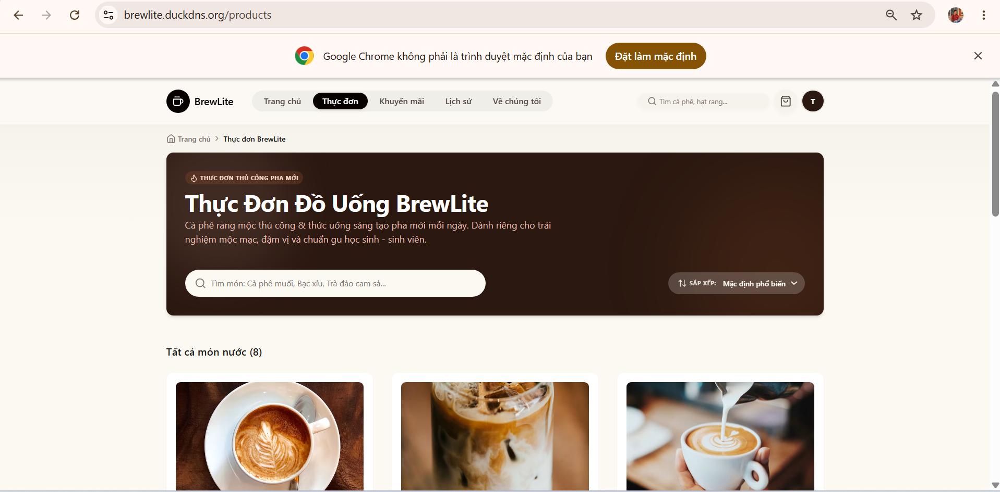
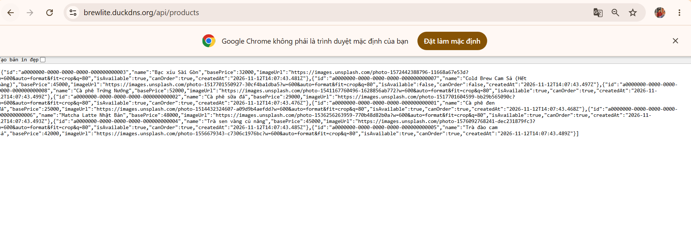

# Báo Cáo Triển Khai & Kiểm Tra Sức Khỏe Hệ Thống (Deployment & Healthcheck) - Brewlite

## 1. Thông tin môi trường Production
- **Hạ tầng Server:** AWS EC2 (Ubuntu 26.04.1 LTS - IP: `47.129.101.36`)
- **Domain & Chứng chỉ SSL:** `https://brewlite.duckdns.org` (DuckDNS + Let's Encrypt HTTPS)
- **Kiến trúc triển khai:** Nginx Reverse Proxy + Docker Compose (`brewlite-web`, `brewlite-api`, `brewlite-postgres`, `brewlite-migration`)
- **Ngày kiểm tra:** 13/11/2026

## 2. Kết quả kiểm tra Docker Container & Healthcheck
| Thành phần / Endpoint | Cổng / URL | Kết quả kỳ vọng | Kết quả thực tế | Trạng thái |
| :--- | :--- | :--- | :--- | :---: |
| **Database Migration** | `brewlite-migration` | Chạy `prisma migrate deploy` thành công | `Exited (0)` (Đồng bộ bảng `loyalty_transactions`) | **PASS** |
| **PostgreSQL Database** | `brewlite-postgres` (`5432`) | Container hoạt động ổn định | `Up (healthy)` | **PASS** |
| **Backend API Service** | `brewlite-api` (`3005`) / `/api/products` | Container `healthy`, trả về `HTTP 200` | `Up (healthy)` - `API (3005): HTTP 200` | **PASS** |
| **Web Frontend Service** | `brewlite-web` (`3006`) / `https://brewlite.duckdns.org` | Container `healthy`, giao diện tải đầy đủ | `Up (healthy)` - `Web (3006): HTTP 307` / `HTTPS Domain: HTTP 200` | **PASS** |

## 3. Kết quả Smoke Test nhanh trên Production
- [x] **ST-01 (Auth):** Đăng nhập tài khoản thành công, duy trì phiên làm việc hợp lệ.
- [x] **ST-02 (Catalog):** Tải đầy đủ danh sách 8 món nước và thông tin giá/trạng thái hiển thị.
- [x] **ST-03 (Order & Promo):** Tạo đơn hàng mới và áp dụng mã giảm giá thành công.
- [x] **ST-04 (History & Loyalty):** Hiển thị lịch sử đơn hàng và ghi nhận giao dịch điểm (`LoyaltyTransaction`) ổn định, không phát sinh lỗi 500.

## 4. Hình ảnh minh chứng triển khai thực tế

### 4.1. Trạng thái Docker Containers & Healthcheck trên AWS EC2

### 4.2. Giao diện Web Production (`https://brewlite.duckdns.org/products`)

### 4.3. Backend API Healthcheck (`https://brewlite.duckdns.org/api/products` - HTTP 200)
